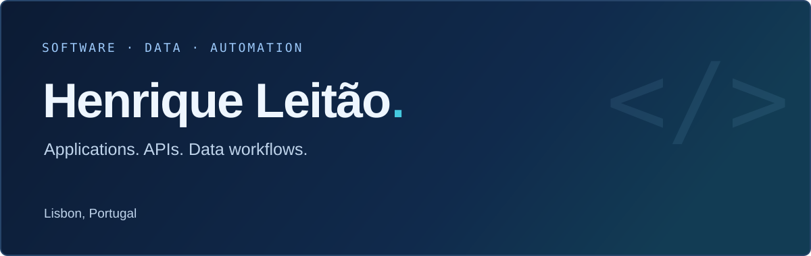

**Software Developer** · Data Engineering & Automation

## Technical toolkit

<table width="100%">
<tr>
<td width="50%" valign="top">
<h3>Web &amp; mobile</h3>

</td>
<td width="50%" valign="top">
<h3>Backend &amp; APIs</h3>

</td>
</tr>
<tr>
<td width="50%" valign="top">
<h3>Data &amp; validation</h3>

</td>
<td width="50%" valign="top">
<h3>Automation &amp; desktop</h3>

</td>
</tr>
</table>

## Engineering focus

<table width="100%">
<tr>
<td width="33%" valign="top">

<h3>Application development</h3>

Web · Mobile · Desktop

</td>
<td width="33%" valign="top">

<h3>Systems integration</h3>

APIs · Services · Databases

</td>
<td width="33%" valign="top">

<h3>Data automation</h3>

Documents · Validation · Workflows

</td>
</tr>
</table>

---

Lisbon, Portugal · [Connect on LinkedIn ↗](https://www.linkedin.com/in/henrique-leitao-626035371/)
